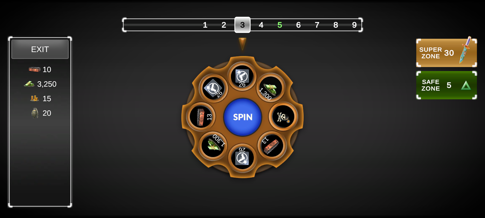
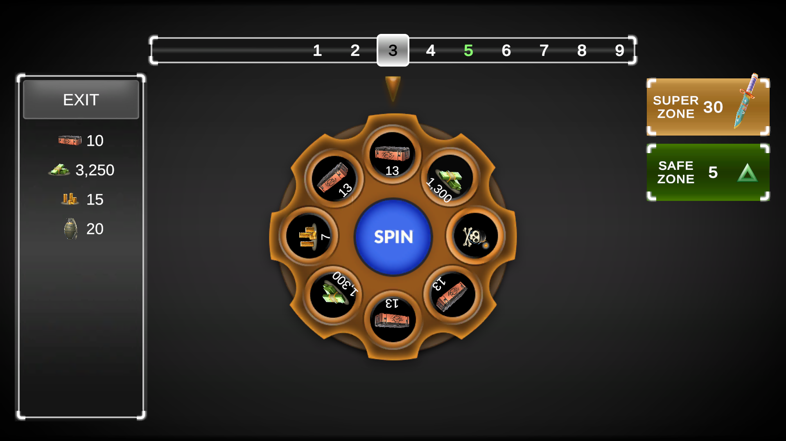
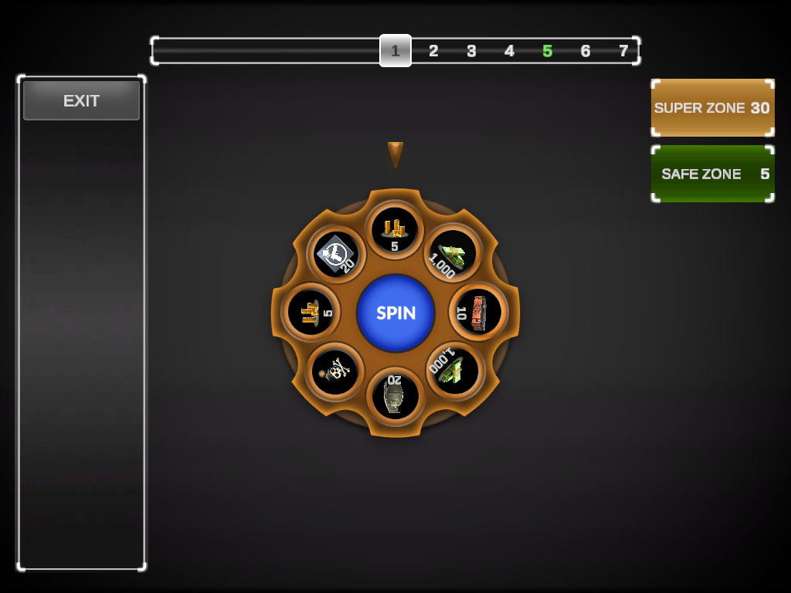
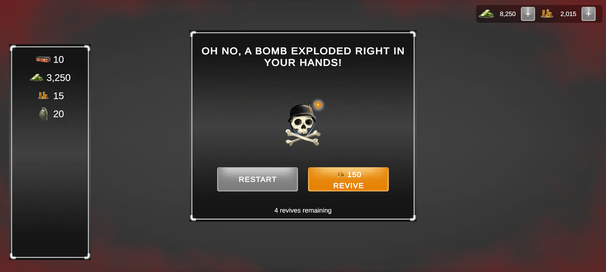
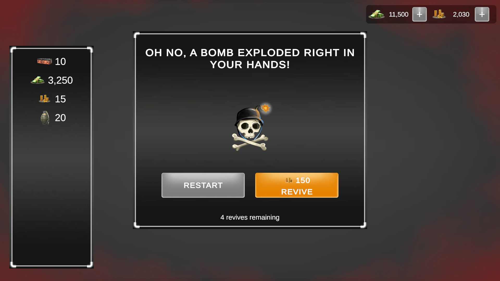
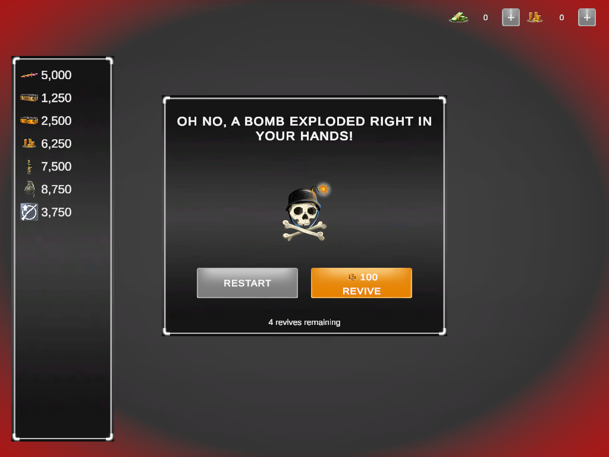
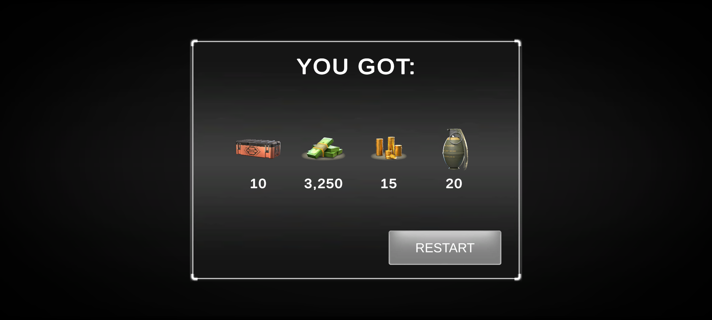
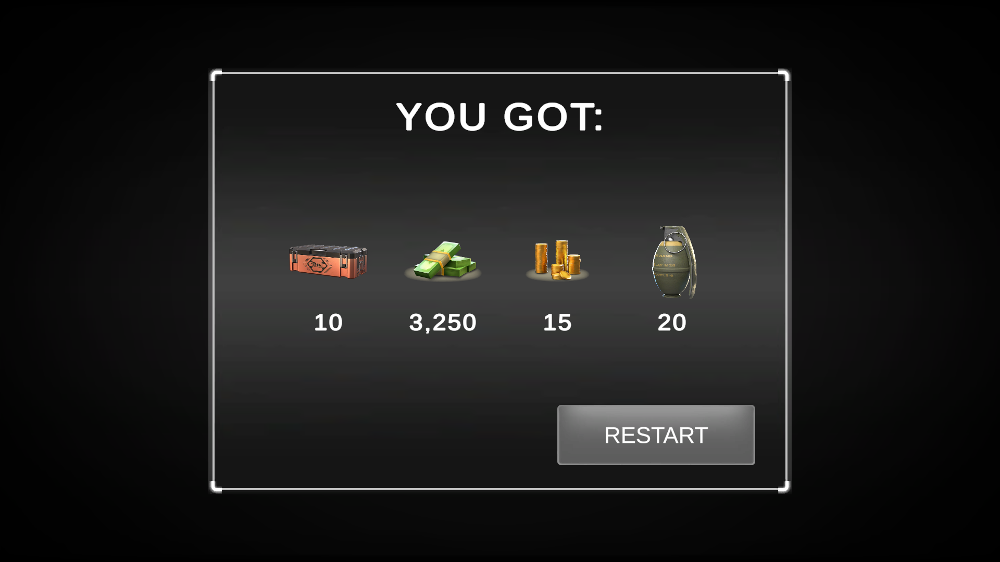
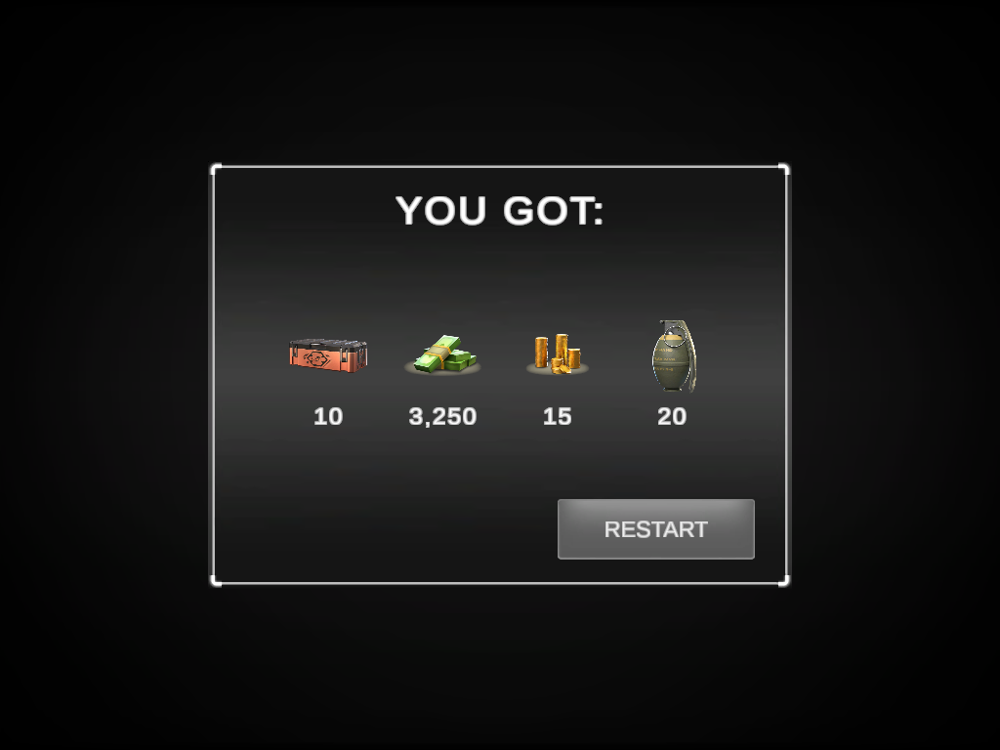

# Wheel of Fortune

A mobile wheel-spin risk game built in Unity for the Vertigo Games game developer case study.

At every zone the player **spins a wheel**. Each normal wheel holds several rewards and exactly one
**bomb**. Spin to grow your loot, or leave from a safe or super zone and bank it before a bomb wipes it out.
Deeper zones offer better rewards, not just bigger numbers.

Gameplay video: https://youtu.be/mDGNfFYK1HE

## Screenshots

| | 20:9 | 16:9 | 4:3 |
|:---|:---:|:---:|:---:|
| Gameplay |  |  |  |
| Loss |  |  |  |
| Results |  |  |  |

## Rules

1. **SPIN** — the result is chosen before the animation starts, so the animation can never change it.
   A reward is added to the run's loot and the run advances to the next zone.
2. **BOMB** — every reward collected in the run is cleared immediately. The wheel shakes, the screen
   flashes and the bomb grows, then the loss panel opens.
   - **RESTART** starts a new run from the configured starting zone. It is free.
   - **REVIVE** spends persistent **Gold**: `100 + 25 × (zone − 1)` by default. It restores the
     rewards the bomb cleared, gives a fresh wheel for the same zone, and is limited to **4 per run**.
     With too little Gold the purchase is rejected and nothing changes; a rejected purchase does not
     use up a revive. Restarting resets the limit. Restored loot is still at risk until you leave.
   - The panel previews the cleared rewards (scrollable) and shows the Cash and Gold balances.
     Their **+** buttons open a demo top-up panel whose Buy/Ad buttons are disabled placeholders:
     no payment happens and no currency is credited.
3. **EXIT** — banks the run. It is only possible in a **safe or super zone**, while the wheel is
   stopped and every presentation (reward flight, showcase, zone transition) has finished.
4. Reaching the configured **final zone** (60 by default) completes the run and banks everything.

Banked rewards that are linked to a currency asset (Cash, Gold) are credited to the persistent
balances only when a run completes successfully. Run loot and persistent balances are kept apart.

### Zones

| Zone (default data) | Wheel | Bomb |
|---|---|---|
| Normal (every zone) | Bronze | exactly one, placed by code |
| **Safe** (every 5th zone) | Silver | none |
| **Super** (every 30th zone, wins over safe) | Golden | none, special rewards |

Every normal wheel gets exactly one bomb from the wheel builder, in a slot chosen again for each zone
by the injected random source (the same slot can come up twice by chance). Authored data cannot add
or remove bombs. Bronze and Silver use different reward pools for zones 1–9, 10–19 and 20 onwards,
so better chests, consumables and weapon points appear as you go deeper; amounts also scale per zone
unless a reward opts out (cosmetics).

## Architecture

| Layer | Responsibility | Main types |
|---|---|---|
| Core (no Unity references) | Rules and flow | `GameSession` and its state objects, `ZoneRules`, `ZoneWheelBuilder`, `RewardWallet`, `CurrencyWallet`, `RevivePolicy`, `EventBus` |
| Data | Authored content adapted into the core | `GameConfiguration`, `ZoneConfiguration`, `ZoneRuleDefinition`, `WheelDefinition`, `RewardDefinition`, `RewardCategoryDefinition`, `CurrencyDefinition`, animation profiles, `ZoneCatalog`, `WheelTierFactory` |
| Game | Composition, input and presentation | `GameCompositionRoot`, `SessionInputController`, `SessionPresenter`, `SessionHudPresenter`, `WheelVisualPresenter`, `RewardPresentationController` |
| UI / Wheel | Views behind interfaces | `GameScreenView`, `FeedbackView`, `ResultsView`, `CurrencyHudView`, `JackpotShowcaseView`, `RewardsListView`, `WheelView`, `WheelSpinner`, `WheelTransitionController` |

- **Unity-independent core.** `Vertigo.WheelOfFortune.Core` is a separate assembly with no Unity
  references: `GameSession`, `ZoneRules`, `ZoneWheelBuilder`, `RewardWallet`, `CurrencyWallet`,
  `RevivePolicy`, `EventBus` and the `IRandomSource` seam. ScriptableObject data is adapted into it
  (`ZoneConfiguration.ToRules()`, `WheelTierFactory`), so every rule is tested without a scene.
- **One state machine.** `GameSession` owns the flow through state objects (Ready, Spinning,
  RewardPresentation, ZoneTransition, Lost, Completed). Each state answers `IsSpinAllowed`,
  `IsLeaveAllowed`, `IsRestartAllowed`, `IsReviveAllowed` and implements only the commands it
  accepts. There is no phase enum, no `switch` over states and no controller-side flow flags, so adding a state does not touch callers.
  Presentation operations complete through versioned, single-use callbacks: a cancelled or stale
  animation can never advance the flow.
- **Single responsibilities.** `GameCompositionRoot` only builds the session-scoped objects and pairs
  their subscriptions with its enable/disable lifecycle. Input routing (`SessionInputController`),
  session presentation (`SessionPresenter`), HUD projection (`SessionHudPresenter`), wheel rendering
  (`WheelVisualPresenter`), wheel transitions (`WheelTransitionController`), reward flights and the
  showcase (`RewardPresentationController`), the debug panel (`AdminPanel`) and the edit-mode
  preview (`WheelEditorPreview`) are separate classes.
- **Interfaces at boundaries.** Presenters talk to views through `ISessionScreenView`,
  `ISessionHudView`, `IWheelView`/`IWheelDisc`, `IWheelSpinPresentation`, `IWheelTransition`,
  `IRewardShowcase`, `IRewardRowTargets`, `IRewardFlight` and `ICurrencyHudView`. Unity references
  are serialized fields; nothing is discovered at runtime.
- **Event bus vs. Actions.** `EventBus` is a session-scoped, generic, type-safe bus for cross-system
  notifications with several possible listeners: `SessionChanged` (HUD projection),
  `RunCompleted` (currency settlement) and `CurrencyBalanceChanged` (balance HUD). Commands with one
  known owner are direct interface calls (`session.BeginSpin()`, `TryRevive()`, …). Local button
  clicks (`UIButton.Clicked`, `FeedbackView.RestartRequested`, …) and animation-completion
  callbacks stay as `Action`/`UnityAction` delegates, because they have a single, nearby listener.
- **Data-driven content.** Zone rule assets define matching (interval, range), priority, wheel, bomb
  policy, leave permission and strip visuals. Gameplay and UI resolve zones through the same core
  `ZoneRules` (`ZoneCatalog` adds the asset visuals), including the "next safe/super zone" maps.
  Rewards carry explicit fields: category asset (display order), showcase flag, zone availability,
  amount scaling, icon scale and optional currency. IDs only identify content. New rewards, wheel
  tiers, zone types, categories and currencies are new assets; no code changes are needed.
  Invalid data (unknown reward IDs, empty pool entries, uncovered or ambiguous zones) is rejected.
- **Animation profiles.** Every tween reads its durations, delays, easing, scales, alphas and tints
  from ScriptableObject profiles validated with `[Min]`/`[Range]`: `WheelSpinAnimation`,
  `WheelTransitionAnimation`, `ZoneStripAnimation`, `RewardFlyAnimation`, `RewardListAnimation`,
  `ShowcaseAnimation`, `PanelAnimation`, `IndicatorFlickAnimation` (the pointer kicks on every
  slice tick), `BombImpactAnimation` (shake, flash and bomb growth before the loss panel) and
  `CountUpAnimation` (reward amounts and balances roll to their new value).
- **Loss presentation.** The session hands the bomb slot to `ShowLoss`. `BombImpactView` plays the
  hit and hands off to the loss panel and loss-screen balances through a single-use callback.
  Restart, revive and results cancel a pending hand-off, so a stale impact can never reopen the
  panel.
- **Economy.** `CurrencyWallet` supports any number of currencies with checked credit and spend;
  insufficient funds leave the balance untouched. Each `CurrencyDefinition` has a starting balance
  (default data: 750 Gold, 4,000 Cash) that new players get until a balance is first saved; a saved
  zero is never topped up again. `PlayerPrefsCurrencyStore` is a local demo
  adapter, not a tamper-resistant backend.

### Listener lifecycle

- `GameCompositionRoot` composes the session in `Start` and then binds listeners. Every later
  `OnEnable`/`OnDisable` binds or unbinds them. The first `OnEnable` runs before composition, so it
  skips binding. Every binding is idempotent, and the event bus also ignores duplicate handlers.
- Views pair their own button and event subscriptions in `OnEnable`/`OnDisable` (`UIButton`,
  `FeedbackView`, `ResultsView`, `CurrencyHudView`, `JackpotShowcaseView`,
  `RewardPresentationController`, and `WheelIndicatorFlick` listening to the local `SliceTicked`
  event of `WheelSliceTickSound`). PlayMode tests cover repeated enable/disable cycles.
- Every tween is linked to its owner with `SetLink(gameObject)` and killed on disable/destroy.
  Callbacks are named methods. Interrupted count-ups settle on their target when disabled.
  The pointer flick restarts one reusable sequence per tick instead of allocating. Runtime resources (the loss-dim material, generated vignette
  textures) are destroyed when no longer needed.

### Admin panel (debug builds only)

Tap the invisible bottom-right corner 4 times within 1.5 seconds to open it (both values are
serialized). It shows the current state, zone, revives and balances, and offers zone jumps (±1, ±5,
next safe, next super), a forced next spin (a chosen slot or the bomb), animation speed (1×, 0.5×,
0.25× via `DOTween.timeScale`) and currency tools (grant, set Gold to 0, reset to starting
balances).

- It exists only in the editor and development builds: `AdminPanel` deactivates itself when
  `Debug.isDebugBuild` is false, and the composition root binds it only in debug builds.
- Commands use the public session and wallet APIs. Zone jumps are accepted only by the Ready state.
  A forced spin goes through `ForcedOutcomeRandom`, a decorator on a separate spin-only random
  source, so it can never change wheel building or the one-bomb rule. A forced slot is cleared if
  the wheel is replaced before the spin.
- The readout refreshes from `SessionChanged` and `CurrencyBalanceChanged` on the event bus;
  disabling the panel unsubscribes and restores the animation speed.

### UI

- Canvas Scaler **Scale With Screen Size / Expand** (1920×1080 reference), TextMeshPro everywhere,
  and no persistent inspector `OnClick` calls; buttons register listeners in code.
- Sliced images use sprites with nonzero 9-slice borders; simple images preserve aspect.
- Modal panels (loss, results, showcase, top-up) hide and disable the HUD and the wheel, then restore
  their previous state.
- Names go from general to specific with a type token (`ui_image_rewards_background`); `_value`
  marks exactly the elements that change at runtime.
- Reward rows, result tiles, wheel slots and flying icons are pooled instances of authored prefabs.

## Tests

**132 test cases: 107 EditMode + 25 PlayMode**, all passing (Unity Test Runner, Unity 6000.3.23f1).

- **EditMode** (`Assets/_Game/Tests/EditMode`): bomb clears the wallet; exit only in safe/super
  zones while stopped; exactly one bomb on normal wheels and none on safe/super; deterministic bomb
  slot selection; forced spin outcomes that never touch wheel building; the bomb slot handed to the
  loss presentation; reward-pool progression; state input gating and stale-completion rejection;
  revive pricing, limits and insufficient funds; currency spending, persistence and starting
  balances; event bus subscription semantics; zone rule resolution and next-zone lookup; scene and
  prefab contracts (naming, sliced borders, aspect, broken references, Canvas Scaler, TextMeshPro,
  persistent calls, modal HUD coverage).
- **PlayMode** (`Assets/_Game/Tests/PlayMode`): repeated enable/disable of buttons, modals and rows;
  cancelled transitions and presentations that never advance the flow; pooled slot reuse across
  zones; vignette resource release; loss and top-up panels; single-use reward completion; bomb
  impact hand-off and cancellation; admin tap gesture, forced bomb spin and speed reset; pointer
  flick reset on disable; count-up rolling and settling.

Run them from Window > General > Test Runner.

## Tech

- **Unity 6000.3.23f1**, URP 2D, Input System, TextMeshPro, Sprite Atlas
- **DOTween** (vendored under `Assets/Plugins/Demigiant`)
- `com.coplaydev.unity-mcp` is an editor-only development tool pinned to a fixed commit; the game
  does not depend on it.

### Project structure

```
Assets/_Game/
├─ Scripts/
│  ├─ Core/    → Unity-independent gameplay assembly (session states, rules, wallets, event bus)
│  ├─ Data/    → ScriptableObject definitions, animation profiles, ZoneCatalog, WheelTierFactory
│  ├─ Game/    → composition root, presenters, input controller, dev/editor helpers
│  ├─ UI/      → HUD, loss panel, results, rewards list, showcase, currency HUD
│  ├─ Wheel/   → wheel layout, spinner, transition, tick sound
│  └─ Editor/  → atlas builder, reward metadata validator
├─ Data/       → game config, zone rules, wheels, pools, rewards, categories, currencies, animations
├─ Prefabs/    → wheel slice, reward row, result tile, fly icon, zone node
├─ Scenes/     → Game.unity
└─ Tests/      → EditMode and PlayMode suites
```

## Build

- Platform: **Android** (Min SDK 25, ARM64, IL2CPP)
- Build from File > Build Profiles > Android > Build; `Game.unity` is the only scene in the build.

## Author

**Semih B. Ceylan**
